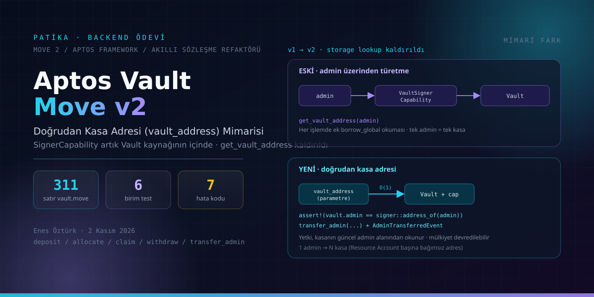
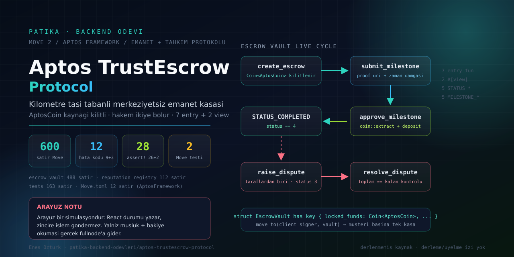
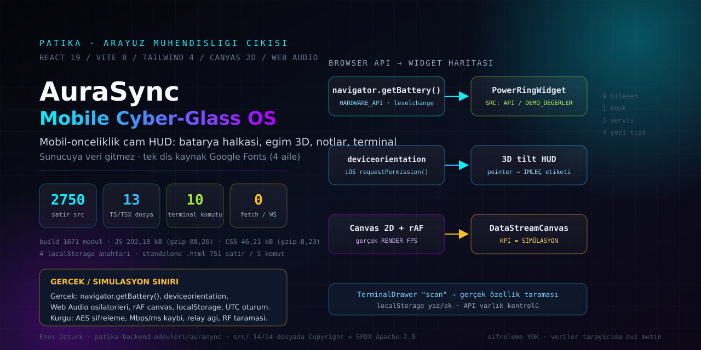
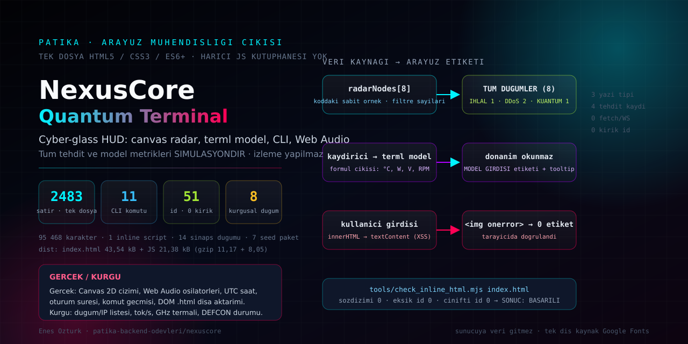

<div align="center">

# Patika Backend Ödevleri

[Patika](https://patika.dev) backend yolculuğundaki ödev ve projelerin **depo kökü**.
Her ödev kendi klasöründe; blokzincir, GraphQL, Node ve mimari refaktör işleri — artık arayüz
mühendisliği çıktıları da — burada toplanır.

[](#içerik)
[](#içerik)
[](#görsel-standartları)
[](#içerik)
[](#imza-ve-haklar)

</div>

---

## Kapak galerisi

Her ödevin kapağı **elle yazılmış SVG vektördür** (`<ödev>/docs/cover.svg`) ve üzerindeki her sayı
kaynak koddan doğrulanır — jenerik görsel kullanılmaz.

| [**1 · Aptos Vault Move v2**](aptos-vault-move-v2/README.md) | [**2 · Aptos TrustEscrow**](aptos-trustescrow-protocol/README.md) |
|:---:|:---:|
|  |  |
| [**3 · AuraSync — Mobile Cyber-Glass OS**](aurasync/README.md) | [**4 · NexusCore — Quantum Terminal**](nexuscore/README.md) |
|  |  |

---

## İçerik

| # | Ders / Teknoloji | Ödev | Ne içeriyor | Durum |
|---|---|---|---|---|
| 1 | **Aptos · Move 2** | [Aptos Vault Move v2 — Doğrudan Kasa Adresi Mimarisi & Test Portalı](aptos-vault-move-v2/README.md) | `vault_address` refaktörü, 311 satır sözleşme, 6 birim test, `transfer_admin` bonusu, React 19 portalı ve üretilmiş gerçek Move paketi | ✅ tamamlandı · ⚠️ gaz/devnet iddiaları [§11](aptos-vault-move-v2/README.md#11-dürüstlük-rehberi-kod-mu-vitrin-mi)'de dürüstçe sınırlanmıştır |
| 2 | **Aptos · Move 2 + React 19** | [Aptos TrustEscrow Protocol — Kilometre Taşı Tabanlı Emanet & Hakem Tahkimi](aptos-trustescrow-protocol/README.md) | 600 satır Move (488 + 112), 7 `entry fun` + 2 `#[view]`, `Coin<AptosCoin>` kaynağı ile kilitleme, 9 hata kodu, 12 `assert!` ile 2 birim test, 5 sekmeli simülasyon paneli | ✅ teslim · ⚠️ derlenmemiş kaynak, dağıtım/cüzdan iddiaları ve 14 sözleşme kusuru [§8](aptos-trustescrow-protocol/README.md#8-dürüstlük-rehberi-sözleşmede-kalan-kusurlar)–[§9](aptos-trustescrow-protocol/README.md#9-doğrulanamayan-iddialar-orijinal-arşivden-çıkarıldı)'da |
| 3 | **React 19 · Vite 8 · Tailwind 4** | [AuraSync — Mobile Cyber-Glass OS](aurasync/README.md) | 13 TS/TSX dosya · 2.750 satır, 9 bileşen, batarya/eğim/audio canvas sensör katmanı, 10 komutluk terminal, `localStorage` notları, bağımlılıksız 751 satırlık standalone `.html`, `src/` 14/14 dosyada telif başlığı | ✅ teslim · `tsc --noEmit` 0 hata, build 1.671 modül · ⚠️ ağ/KPI sayıları simülasyon, şifreleme yok: [§4](aurasync/README.md#4-dürüstlük-rehberi-gerçek-olan--kurgu-olan) |
| 4 | **Vanilla HTML · Canvas 2D · Web Audio** | [NexusCore — AI Quantum Terminal & Threat Visualizer](nexuscore/README.md) | Tek dosya `index.html` (2.483 satır), dönen canvas radar + 8 örnek düğüm, termal model formülü, 11 komutluk CLI, kendi statik denetleyicimiz (`0` kırık id) | ✅ teslim · `SONUC: BASARILI` · ⚠️ tehdit/metrik verileri kurgusal, iki `innerHTML` batığı kapatıldı: [§5](nexuscore/README.md#5-dürüstlük-rehberi-gerçek-olan--kurgu-olan)–[§7](nexuscore/README.md#7-bu-oturumda-düzeltilen-gerçek-kusurlar) |

## Klasör yapısı

```text
patika-backend-odevleri/
├── aptos-vault-move-v2/
│   ├── contracts/
│   │   ├── package/        ← `aptos move test` ile doğrudan çalıştırılabilir gerçek paket
│   │   ├── legacy/         ← v1 referans sözleşmesi (pakete dahil değil)
│   │   └── extract_move.mjs← Move kaynaklarını src/data'daki metinlerden üretir
│   ├── docs/cover.svg      ← ödevin özel kapağı (elle yazılmış vektör)
│   ├── src/                ← 5 sekmeli inceleme portalı (React 19 + Vite 8 + Tailwind 4)
│   └── README.md           ← ödevin tam belgesi
├── aptos-trustescrow-protocol/
│   ├── contracts/
│   │   ├── Move.toml       ← tek bağımlılık: AptosFramework
│   │   ├── sources/        ← escrow_vault (488) + reputation_registry (112)
│   │   └── tests/          ← trust_escrow_tests.move (2 test, 12 assert)
│   ├── docs/cover.svg      ← ödevin özel kapağı (elle yazılmış vektör)
│   ├── src/                ← 5 sekmeli emanet operatörü (yaşam döngüsü yerel simülasyondur)
│   └── README.md           ← §8'de 14 sözleşme kusuru, §9'da arşivden silinen iddialar
├── aurasync/
│   ├── src/
│   │   ├── components/     ← 9 bileşen: batarya halkası, tilt HUD, canvas, terminal, notlar
│   │   ├── hooks/          ← useDeviceSensors.ts (Battery + deviceorientation + sayaçlar)
│   │   └── services/       ← soundFx.ts (Web Audio osilatörleri, mute kalıcılığı)
│   ├── public/aurasync-standalone.html ← bağımlılıksız tek dosya kopya (751 satır, 5 komut)
│   ├── docs/cover.svg      ← ödevin özel kapağı (elle yazılmış vektör)
│   └── README.md           ← §4'te gerçek ↔ kurgu tablosu, §5'te kapatılan kusurlar
├── nexuscore/
│   ├── index.html          ← 2.483 satır: markup + CSS + ES6+ modül (tek uygulama dosyası)
│   ├── tools/check_inline_html.mjs ← kendi denetleyici: söz dizimi, eksik id, çift id
│   ├── docs/cover.svg      ← ödevin özel kapağı (elle yazılmış vektör)
│   └── README.md           ← §5'te veri kaynağı etiketleri, §6'da doğrulama çıktısı
├── LICENSE                   ← Apache-2.0: apache.org'dan birebir indirilmiş metin (SHA-256 §"İmza ve haklar")
├── NOTICE                    ← telif beyanı, üçüncü taraf varlıklar, SPDX kapsamı (17/58) ve ölçüm komutu
├── .gitattributes            ← metin dosyalarında LF standardı: ölçümler platformdan bağımsız kalır
└── README.md               ← bu dosya (depo kökü indeksi)
```

## Nasıl okunur

Her ödev klasörünün kendi `README.md`'si üç şeyi birlikte verir:

1. **Ödevin isteği ve yapılanlar** — tablolar ve kod alıntılarıyla.
2. **Çalıştırma** — hangi komutun neyi ürettiği, hangi araçların kurulu olması gerektiği.
3. **Dürüstlük rehberi** — iddiaların kaynak koda ve zincir üstü API'lere karşı kontrolü.
   Ölçülmemiş sayıların "ölçüm" gibi sunulmasına burada izin verilmez.

Ödevleri değerlendirirken o klasörün **son bölümünü önce okuyun**.

## Kanıt zinciri

Son doğrulama, `main` dalından yeni alınmış bir klon üzerinde yapıldı (bu satırlar yazıldığında
`e5ba931`):

| Adım | Komut | Sonuç |
|---|---|---|
| Klon | `git clone --depth 1 …` | `HEAD = e5ba931`, 100 izlenen dosya |
| Kök dosyalar | `ls LICENSE NOTICE .gitattributes` | üçü de depoda; GitHub sayfası "Apache-2.0" diyor |
| Kapaklar | `git ls-files \| grep cover.png` | 4 SVG + 4 PNG (1280×640) |
| NexusCore denetim | `node tools/check_inline_html.mjs index.html` | 95.468 karakter / 2.483 satır, 0 hata, 0 eksik id, 0 çift id |
| NexusCore derleme | `npm install && npm run build` | 43,54 kB HTML + 21,38 kB JS |
| AuraSync derleme | `npm install && npm run lint && npm run build` | `tsc --noEmit` 0 hata; 292,18 kB JS / 46,21 kB CSS |
| Telif kapsamı | `NOTICE` içindeki komut | 58 kaynak dosyanın 17'sinde SPDX başlığı |

Klon `--depth 1` ile alındığı için geçmiş commit'ler burada değil; zincirin tamamı
`git log origin/main` ve GitHub'ın commit sayfasında görülüyor.

## Görsel standartları

- Her ödevin kapağı `<ödev>/docs/cover.svg` içinde **elle yazılmış vektördür**; jenerik AI
  görseli kullanılmaz. Kapak, o ödevin gerçek sayılarını (dosya/satır/test/adres sayısı) taşır.
- Kapaktaki her sayı kaynak koddan doğrulanır; sayı değişirse kapak da güncellenir.
- Her kapağın **1280×640 PNG renderi** `docs/cover.png` olarak depoda durur; SVG'den
  `@resvg/resvg-js` ile türetilmiştir (araç depoya bağımlılık olarak eklenmez, geçici dizinde
  kurulur). GitHub **Settings → Social preview** için doğrudan bu dosya yüklenir; SVG değişirse
  PNG yeniden üretilir.

## İmza ve haklar

- Depodaki dört çalışmanın **tasarımı ve kodu Enes Öztürk'e aittir**; katkı hakları (telif) saklıdır.
- Beyan her ödevin içinde de görünür: ödev README'sinin başlığı, `docs/cover.svg` altbilgisi ve
  arayüzün kendi künyesi (AuraSync `about` komutu + Architect HUD, NexusCore altbilgi + `SYSTEM SPECS`).
- Kök lisans **`LICENSE`** dosyasıdır: `https://www.apache.org/licenses/LICENSE-2.0.txt` adresinden
  birebir indirilmiş Apache-2.0 metni (202 satır, 11.358 bayt,
  SHA-256 `cfc7749b96f63bd31c3c42b5c471bf756814053e847c10f3eb003417bc523d30`).
  Atıf ve üçüncü taraf varlık listesi **`NOTICE`** dosyasındadır.
- Elle yazılmış kaynak dosyaların **17'si** (toplam 58) başlığında `SPDX-License-Identifier: Apache-2.0`
  beyanını taşır; beyanı olmayan dosyalar da `LICENSE` + `NOTICE` ile aynı lisansa tabiidir.
  Bu iki sayı `NOTICE` içindeki komutla yeniden ölçülebilir.
- Üçüncü taraf varlıklar kaynak gösterilir: Google Fonts yazı tipleri, React 19 / Vite 8 / Tailwind 4 /
  lucide-react, Aptos Framework (Move). Bu depoda **başkasına ait kod "benim" diye sunulmaz**;
  simülasyon olan hiçbir şey "gerçek ölçüm" diye de sunulmaz.

## Notlar

- 3 ve 4 numaralı ödevler **arayüz mühendisliği** çıktısıdır: ikisi de tarayıcıda çalışır, sunucusuzdur
  ve veri iddialarını kendisi etiketler (simülasyon/metrik ayrımı arayüzün içinde de yazılıdır).
- Kök `.gitignore` ortam dosyalarını (`.env`, `.env.*`, `*.pem`) dışarıda tutar.
- Bu depo, aynı yazarın [patika-dev-odevler](https://github.com/EnesBinMalik/patika-dev-odevler)
  arşivinin **backend** tarafını toplar; arşiv çatısının tamamı orada, 63 proje klasörünün
  haritası da oranın kök README'sindedir.
- Lisans: kökte `LICENSE` (Apache-2.0, birebir) ve `NOTICE` (telif + üçüncü taraf varlıklar).
  Kaynak dosyaların 17/58'inde ayrıca `SPDX-License-Identifier: Apache-2.0` başlığı var.
- `.gitattributes` tüm metin dosyalarını depoda ve checkout'ta **LF** ile tutar; böylece
  README'lerdeki karakter/satır ölçümleri Windows klonunda da aynı kalır
  (`core.autocrlf=true` iken bile).
