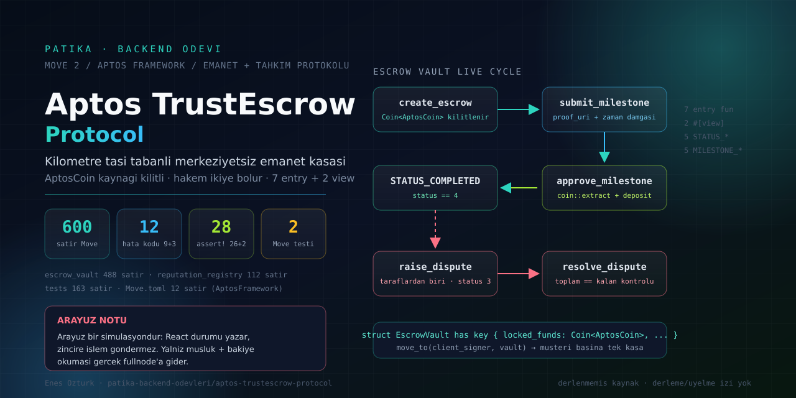

# Aptos TrustEscrow Protocol



> **Kilometre taşı (milestone) tabanlı, hakem denetimli merkeziyetsiz emanet (escrow) protokolü.**
> Depoda iki ayrı katman var: **gerçek Move sözleşme kaynakları** (`contracts/`) ve bu sözleşmeleri
> taklit eden bir **React arayüzü** (`src/`). Bu README, hangi katmanın ne olduğunu ve hangi
> iddiaların bu depodan doğrulanabildiğini açıkça ayırır.

**Geliştirici:** Enes Öztürk · **Hedef ağ:** Aptos Testnet · **Dil:** Move 2 + React 19 / TypeScript / Vite 8

| | |
|---|---|
| Sözleşme modülü | `trust_escrow::escrow_vault` — [`contracts/sources/trust_escrow.move`](contracts/sources/trust_escrow.move) (488 satır) |
| İtibar modülü | `trust_escrow::reputation_registry` — [`contracts/sources/reputation_registry.move`](contracts/sources/reputation_registry.move) (112 satır) |
| Testler | [`contracts/tests/trust_escrow_tests.move`](contracts/tests/trust_escrow_tests.move) (163 satır, **2** test, 12 `assert!`) |
| Arayüz | 5 sekme: Emanet Kasaları · Yeni Sözleşme · Move Stüdyosu · İtibar & Ağ · README & Rehber |
| Derleme durumu | Bu depoda `aptos move compile` / `aptos move test` **çalıştırılmadı** (`aptos` CLI kurulu değil) |
| Zincir dağıtımı | Yok. Arayüzdeki adres bir demo sabitidir; publish işlem izi bulunmuyor |

---

## 1. Ne yapar, ne yapmaz

| Yetenek | Durum | Kanıt |
|---|---|---|
| Emanet kasası kuralları (kilitleme, aşama onayı, tahkim, iptal) | **Kodda var** | `trust_escrow.move` içinde 7 `public entry fun` + 2 `#[view]` |
| Zincir üstü para taşıma | **Kodda var** | `coin::withdraw` (:201), `coin::extract` (:326, :414, :419), `coin::deposit` (:327, :415, :420, :458) |
| Olay (event) yayını | **Kodda var** | `EscrowCreatedEvent`, `MilestoneEvent`, `DisputeEvent` |
| Arayüzden sözleşme çağırma | **YOK** | Depoda transaction imzalayan bir kod yok; işlemler React durumunda simüle edilir |
| Cüzdan eklentisi (Petra/Pontem/Martian) | **YOK** | `package.json` içinde `@aptos-labs/*` bağımlılığı yok |
| Gerçek ağ teması | **Kısmen** | Yalnızca testnet musluğuna POST ve fullnode'dan bakiye okuma (`src/services/aptosService.ts`) |
| İtibar panosundaki sayılar | **Sabit veri** | `reputation_registry.move` zincirinden okunmaz |
| Move Stüdyosu test konsolu | **Animasyon** | `handleRunTests` yalnızca ekrana yazar; `aptos move test` çalıştırmaz |

---

## 2. Hızlı başlangıç

### 2.1 Arayüz

```bash
cd aptos-trustescrow-protocol
npm install          # 46 paket; kilit dosyası package-lock.json
npm run dev          # http://localhost:3000
npm run lint         # tsc --noEmit
npm run build        # vite build -> dist/
```

Bu depo işlenirken doğrulananlar: `tsc --noEmit` hatasız, `vite build` başarılı (1681 modül, ~345 kB JS),
tarayıcıda 5 sekmenin tamamı açıldı ve konsolda uyarı/hata yok; kasa oluşturma (−6 APT), aşama onayı
(+4.5 APT), iptal iadesi (+6 APT) ve hakem dağıtımı (7.5/7.5) akışları canlı olarak test edildi.

### 2.2 Move paketini derlemek ve test etmek (Aptos CLI gerekir)

```bash
npm run compile:move   # cd contracts && aptos move compile --named-addresses trust_escrow=default
npm run test:move      # cd contracts && aptos move test
```

CLI kurulumu: <https://aptos.dev/en/build/cli>. Bu makinede CLI bulunmadığı için **bu iki komut burada
koşulmadı**; §9'daki riskler bu yüzden hâlâ açık.

### 2.3 Dağıtım (kendi testnet profilinizle)

```bash
aptos init --network testnet
aptos account fund-with-faucet --account default --amount 1000000000
cd contracts
aptos move publish --named-addresses trust_escrow=default --assume-yes
```

Yayınladıktan sonra `CONTRACT_ADDRESS` (`src/data/initialData.ts:6`) kendi adresinizle değiştirilmeli;
paketteki `escrow_vault` ve `reputation_registry` modülleri tek pakette dağıtılır.

---

## 3. Depo yapısı

```text
aptos-trustescrow-protocol/
├── contracts/                      # Move 2 paketi (arayüzden bağımsız gerçeğin kaynağı)
│   ├── Move.toml                   # 12 satır; yalnızca AptosFramework bağımlılığı
│   ├── sources/
│   │   ├── trust_escrow.move       # escrow_vault: 488 satır, 9 hata kodu, 7 entry fun, 2 view
│   │   └── reputation_registry.move# 112 satır, zincir üstü itibar profili
│   └── tests/
│       └── trust_escrow_tests.move # 163 satır, #[test_only] escrow_vault_tests, 2 test
├── src/
│   ├── App.tsx                     # durum makinesi + 8 handler (tümü yerel simülasyon)
│   ├── data/initialData.ts         # demo hesaplar, 3 hazır emanet, endpoint sabitleri
│   ├── services/aptosService.ts    # tek gerçek ağ teması: faucet POST + fullnode bakiye GET
│   ├── assets/images.ts            # 4 JPG'yi ES importu olarak dışa aktarır
│   └── components/                 # Header, HeroSection, EscrowList/Card, CreateEscrowModal,
│                                   # MoveStudio, ReputationAnalytics, DocumentationViewer, Footer
├── docs/cover.svg                  # bu dosyanın kapağı (elle yazılmış SVG)
├── package.json                    # Vite 8 + React 19 + Tailwind 4
├── metadata.json                   # AI Studio proje meta verisi
└── index.html / vite.config.ts / tsconfig.json
```

---

## 4. Sözleşme yüzeyi (`trust_escrow::escrow_vault`)

| Fonksiyon | Satır | Yetki | Temel abort'lar |
|---|---|---|---|
| `init_registry(&signer)` | :122 | herkes (kendi hesabı) | — |
| `create_escrow(&signer, contractor, arbitrator, title, deposit, titles, amounts, deadline)` | :150 | müşteri (fonları o çeker) | `E_INVALID_ARBITRATOR`, `E_INVALID_STATE`, `E_INSUFFICIENT_FUNDS` |
| `submit_milestone(&signer, vault_owner, milestone_id, proof_uri)` | :237 | `vault.contractor` | `E_VAULT_NOT_FOUND`, `E_NOT_AUTHORIZED`, `E_INVALID_STATE`, `E_ALREADY_SUBMITTED`, `E_MILESTONE_NOT_FOUND` |
| `approve_milestone(&signer, vault_owner, milestone_id)` | :289 | `vault.client` | `E_VAULT_NOT_FOUND`, `E_NOT_AUTHORIZED`, `E_INVALID_STATE`, `E_MILESTONE_NOT_FOUND` |
| `raise_dispute(&signer, vault_owner)` | :364 | müşteri **veya** yüklenici | `E_NOT_AUTHORIZED`, `E_INVALID_STATE` |
| `resolve_dispute(&signer, vault_owner, client_refund, contractor_payout)` | :397 | `vault.arbitrator` | `E_NOT_AUTHORIZED`, `E_INVALID_STATE`, `E_INVALID_SPLIT` |
| `cancel_escrow(&signer, vault_owner)` | :445 | müşteri, yalnız `released_amount == 0` | `E_NOT_AUTHORIZED`, `E_INVALID_STATE`, `E_CANNOT_CANCEL` |
| `get_escrow_info(address): (u64, address×3, u64, u64, u8, u64)` `#[view]` | :467 | salt okunur | `E_VAULT_NOT_FOUND` |
| `get_milestone_count(address): u64` `#[view]` | :483 | salt okunur | `E_VAULT_NOT_FOUND` |

Hata kodları (:20-28): `E_NOT_AUTHORIZED=1`, `E_INVALID_STATE=2`, `E_INSUFFICIENT_FUNDS=3`,
`E_MILESTONE_NOT_FOUND=4`, `E_ALREADY_SUBMITTED=5`, `E_INVALID_ARBITRATOR=6`, `E_CANNOT_CANCEL=7`,
`E_VAULT_NOT_FOUND=8`, `E_INVALID_SPLIT=9` — dokuzunun da en az bir kullanım noktası var.

Toplam **26 `assert!`** çağrısı `escrow_vault` içinde; yetki denetimleri her yazma yolunda
`signer::address_of` + alan karşılaştırması biçiminde kurulmuş (`E_NOT_AUTHORIZED` 5 kullanımda).

### 4.1 Kaynak modeli

- `Milestone has store, drop, copy` (:52): `id, title, description, amount_octas, status, proof_uri, submitted_at, approved_at`
- `EscrowVault has key` (:63): `locked_funds: Coin<AptosCoin>` ile parayı **kaynak olarak** tutar;
  `move_to(client_signer, vault)` (:218) kasayı **müşterinin adresine** yerleştirir → `vault_owner` lookup'ı adres üzerinden
- `EscrowRegistry has key` (:78): `escrows: vector<u64>`, `next_escrow_id` ve üç olay kolu (`created/milestone/dispute`)
- Durum sabitleri: `STATUS_CREATED=1 … STATUS_CANCELLED=5` (:33-37), `MILESTONE_PENDING=1 … MILESTONE_REFUNDED=5` (:42-46)

### 4.2 Yaşam döngüsü

```text
create_escrow ──▶ STATUS_ACTIVE(2)
   aşama 1 = MILESTONE_IN_PROGRESS(2), diğerleri MILESTONE_PENDING(1)
   submit_milestone  : IN_PROGRESS/SUBMITTED → SUBMITTED(3) + proof_uri + submitted_at
   approve_milestone : SUBMITTED|IN_PROGRESS  → APPROVED(4), coin::extract+deposit, sıradaki PENDING aktive olur
   tümü APPROVED     → STATUS_COMPLETED(4)

STATUS_ACTIVE ──raise_dispute──▶ STATUS_DISPUTED(3) ──resolve_dispute──▶ STATUS_COMPLETED(4)
STATUS_ACTIVE (released == 0) ──cancel_escrow──▶ STATUS_CANCELLED(5) + extract_all iade
```

### 4.3 `trust_escrow::reputation_registry` (112 satır · 2 entry fun · 1 view · 2 `assert!`)

| Fonksiyon | Satır | Not |
|---|---|---|
| `init_profile(&signer)` | :39 | `ReputationProfile` kaynağını açar; `E_ALREADY_INITIALIZED` ile tek seferlik |
| `record_completion(&signer, target_user, volume_octas, score)` | :61 | tek denetimi `1 <= score <= 5`; **çağıranın yetkisi denetlenmez** |
| `get_reputation(address): (u64,u64,u64,u64,u64)` `#[view]` | :98 | profil yoksa `(0,0,0,0,0)` döner |

`ReputationProfile has key` (:16) alanları: `user, completed_contracts, total_volume_octas, rating_sum,
rating_count, disputed_contracts, created_at, last_active`. Üç hata kodu tanımlı (:12-14);
`E_NOT_AUTHORIZED` **yalnızca bildirildiği satırda** geçer, hiçbir `assert!` onu kullanmaz.

---

## 5. Testler (gerçek durum)

`contracts/tests/trust_escrow_tests.move` içinde **iki** test var. İkisi de
`timestamp::set_time_has_started_for_testing` (:20, :115), `account::create_account_for_test` ve
`aptos_coin::initialize_for_test` + `coin::register` kullanıyor.

| Test | Satır | Akış | Doğrulanan sayısal değerler |
|---|---|---|---|
| `test_create_and_release_milestone` | :13 | 10 APT yatır → aşama 1 sun/onayla → aşama 2 sun/onayla | `escrow_id==1`, `total==1000000000`, `released==0`, `status==2`, yüklenici `400000000` → `1000000000`, `final_status==4`, kasa bakiyesi `0` (9 `assert!`) |
| `test_dispute_resolution` | :109 | 5 APT yatır → müşteri uyuşmazlık açsın → hakem 50/50 bölsün | `status==3`, müşteri `250000000`, yüklenici `250000000` (3 `assert!`) |

**Testte olmayan yollar:** `cancel_escrow` (iptal/iade), `submit_milestone` yetkisiz çağrısı,
`resolve_dispute` bölünme toplamı hatası (`E_INVALID_SPLIT`), `reputation_registry` modülünün tamamı.
Dosyada tek bir `#[expected_failure]` bile yok — yani olumsuz (abort beklenen) senaryolar hiç denetlenmiyor.

Move Stüdyosu paneli ve `aptosService.getInitialTests()` bu **iki** testi gösterir; gas/süre değerleri
simülasyondur, ölçülmemiştir.

---

## 6. Arayüz katmanı

| Sekme | Bileşen | Gerçek / simülasyon |
|---|---|---|
| Emanet Kasaları | `EscrowList` + `EscrowCard` | yerel durum; onay/iptal/tahkim butonları React state yazar |
| Yeni Sözleşme | `CreateEscrowModal` | yerel durum; "Kasayı Oluştur (yerel simülasyon)" |
| Move Stüdyosu | `MoveStudio` | **gerçek kaynak görüntüler** (`?raw` ile `contracts/**` dosyalarını okur); test konsolu animasyon |
| İtibar & Ağ | `ReputationAnalytics` | sabit demo verisi (başlıkta "zincir okuması yok" yazılı) |
| README & Rehber | `DocumentationViewer` | şartname/karılama tablosu; doğrulanamayan satırlar kırmızı/amber rozetli |

Gerçek ağa giden tek iki çağrı (`src/services/aptosService.ts`):

1. `fetchLiveBalance(address)` → `GET {FULLNODE}/accounts/{addr}/resource/0x1::coin::CoinStore<0x1::aptos_coin::AptosCoin>`
   — musluk talebinden sonra `App.tsx` bunu çağırıp tam düğümün verdiği **gerçek** bakiyeyi toast'lar.
2. `requestTestnetFaucet(address, 1.0)` → `POST {FAUCET}?amount=…&address=…` — başarısızsa artık uydurma
   işlem hash üretmez, `{success:false}` döner ve bakiyeyi değiştirmez.

Ağ erişimi olmayan/CORS engelli ortamlarda bu iki çağrı sessizce hata verir; arayüz bunu "musluk isteği
yapılamadı" mesajıyla gösterir.

---

## 7. Bu depo işlenirken düzeltilen kusurlar

| # | Kusur | Düzeltme |
|---|---|---|
| 1 | `assets/*.jpg` yolları düz string olarak (`/src/assets/…`) veriliyordu; `vite build` görselleri paketlemiyordu | `src/assets/images.ts` ile ES importuna çevrildi, 6 kullanım noktası bağlandı |
| 2 | `handleApproveMilestone`, `setState` güncelleyicisi **içinde** hesaplanan `releasedApt`/`contractorAddress` değerlerini dışında okuyordu → daima `0 APT` toast'ı ve yüklenici bakiyesinde artış yok | escrow+milestone `escrows` dizisinden önce bulunur, tutar güncelleme öncesi hesaplanır (tarayıcıda 4.5 APT doğrulandı) |
| 3 | `handleCancelEscrow` aynı kalıpla iade tutarını `0` gösteriyordu | iade tutarı güncelleme öncesi hesaplanır (tarayıcıda 6 APT iade doğrulandı) |
| 4 | Onay akışı milestone durumunu denetlemiyordu: henüz sunulmamış/genel durumdaki aşama da onaylanabiliyordu | `in_progress` veya `submitted` dışındaki aşamalar reddedilir ve hata toast'ı gösterilir |
| 5 | `requestTestnetFaucet` ağ hatasında 64 haneli **uydurma tx hash** üretip "başarılı" dönüyordu | gerçek hatada `success:false` döner; yalan hash üretimi kaldırıldı |
| 6 | `fetchLiveBalance` tanımlıydı ama hiçbir yerden çağrılmıyordu (ölü kod) | musluk sonrasına gerçek fullnode okuması olarak bağlandı |
| 7 | `MoveStudio` içinde 19-187. satırlarda Move sözleşmesinin **kısaltılmış uydurma kopyası** duruyordu (literal `...` yer tutucuları, var olmayan `EscrowRegistry` alanları) | `?raw` import ile `contracts/` altındaki gerçek 4 dosyaya bağlandı |
| 8 | `aptosService.getInitialTests()` gerçekte var olmayan 3 test uyduruyordu (5 test gösteriliyordu) | gerçek 2 teste indirildi, kaynak satır aralıkları eklendi |
| 9 | `contracts/Move.toml` kullanılmayan `AptosStdlib` bağımlılığı içeriyordu (`aptos_std` hiçbir satırda geçmiyor) | bağımlılık bloğu kaldırıldı |
| 10 | Görsel iddialar: `< 0.8 sn` "Sonuçlanma Kesinliği", `100%` "Bağımsız denetçi korumalı", "Doğrulanmış Denetçi", "Bağlı Cüzdan", sahte explorer/PR kanıt linkleri | ölçülemeyenler platform özelliği olarak etiketlendi, `2 test` / `Move 2 · derlenmedi` gibi doğrulanabilir değerlerle değiştirildi, ölü linkler `ipfs://demo-…  (ornek veri)` ile değiştirildi |
| 11 | `vite.config.ts` `__dirname` kullanıyordu (Vite'ın yerel config yükleyicisi uyarısı) | `import.meta.dirname` |
| 12 | Depoda `bun.lock` vardı ama proje npm ile kuruluyordu (çift kilit dosyası) | `bun.lock` silindi, `package-lock.json` eklendi |
| 13 | `package.json` adı `react-example` idi ve kullanılmayan 7 bağımlılık (express, `@google/genai`, motion, tsx, esbuild, autoprefixer, dotenv) taşıyordu | ad `aptos-trustescrow-protocol`, sürüm `1.0.0`; 7 runtime + 6 geliştirme bağımlılığına indirildi; `test:move` ve `compile:move` script'leri eklendi |

---

## 8. Dürüstlük rehberi: sözleşmede kalan kusurlar

Bunlar **bilerek düzeltildi değil, belgelendi**: Move kaynağına dokunmak, derlenmemiş bir paketi
kırabilecek davranış değişiklikleri üretirdi. Satır numaraları mevcut dosyalara ait.

| # | Kusur | Etki |
|---|---|---|
| 1 | `EscrowVault has key` müşterinin adresine `move_to` edilir (:218) ve iptal sonrası kaynak yerinde kalır (:459 `move_from` yok) | **Bir müşterinin adresinde aynı anda yalnız bir kasa olabilir.** İkinci `create_escrow` çalıştırma zamanında kaynak çakışmasıyla abort eder; iptal edilmiş kasa adresi kalıcı olarak bloklar |
| 2 | `deadline` yazılıyor (:215) ama hiçbir fonksiyonda okunmuyor | Sözleşmede **son teslim tarihi zorlaması yok**; arayüzdeki "Bitiş" tarihi dekoratif |
| 3 | `approve_milestone` (:311) `MILESTONE_IN_PROGRESS` durumunu da onaylayabiliyor ve `milestone_id` sırasında sıralama denetlemiyor | Yüklenici kanıt sunmadan aşama onaylanabilir; 2. aşama, 1. onaylanmadan onaylanabilir (parametrik olarak yine de müşteri imzası gerekir) |
| 4 | `create_escrow` (:198) aşama toplamı ≠ depozito ise `E_INSUFFICIENT_FUNDS` atıyor | Yanlış yarı kodu: durum "yetersiz bakiye" değil "tutar uyuşmazlığı"; hata mesajını okuyan araçlar yanıltır |
| 5 | `coin::deposit` alanın CoinStore'una yazılır (:327, :415, :420, :458) | Yüklenici/müşteri `coin::register` etmemişse çağrı framework abort'üyle düşer — sözleşmede bu ön koşul denetlenmiyor |
| 6 | `resolve_dispute` olayı `raised_by: arb_addr` (:432) yazıyor | Zincir üstü olay indeksinde uyuşmazlığı hakemin açtığı görünür; denetim/kayıt analizi bozulur |
| 7 | `escrow_id` registry'de sayaç (:127) ve `escrows: vector<u64>` (:126) tutuluyor, ama kasa yalnızca **adres** üzerinden bulunuyor | ID tabanlı sorgu yok; `get_escrow_info(vault_owner)` ikinci kasayı zaten mümkün kılmadığı için sayaç pratikte dekoratif |
| 8 | `Milestone.description` alanı başlıkla aynı değer dolduruluyor (:186-187) | Ayrı açıklama verilemez; arayüzde görülen "açıklama" zincirde yok |
| 9 | `STATUS_CREATED=1` (:33) ve `MILESTONE_REFUNDED=5` (:46) hiç kullanılmıyor | Move derleyicisi "kullanılmayan sabit" uyarısı verir; durum makinesinde karşılıkları olmayan ölü durumlar |
| 10 | `reputation_registry::record_completion` (:61) hiçbir yetki denetimi yapmıyor | **Herhangi bir imzalayan, herhangi bir hesabın** tamamlanan iş/volume/puan sayaçlarını yükseltebilir (sömürüye açık pano) |
| 11 | `record_completion` profil yoksa sessizce `return` ediyor (:69-72) | Kayıp güncelleme: kayıt yoksa işlem başarıyla "hiçbir şey yapmadan" biter; hata kodu yerine `E_NOT_AUTHORIZED` (:13) bildirilmemiş ve **hiç kullanılmıyor** |
| 12 | Ortalama puan ölçeği tutarsız: olay `rating_sum*100/count` (:83), görünüm `rating_sum*10/count` (:103) | Aynı `total_rating_avg` alanı iki farklı birimde yayılır; zincir okuyan araçlar 10× sapar |
| 13 | `disputed_contracts` yalnız `0` yazılıyor (:49) ve okunuyor (:109) | Uyuşmazlık sayısı asla artmaz; itibar panosu "uyuşmazlık" metriği zincirde hep boş |
| 14 | `escrow_vault` hiçbir yerden `reputation_registry` çağırmıyor (grep: sıfır eşleşme) | Emanet yaşam döngüsü **itibar üretmez**; arayüzdeki itibar kartlarının sözleşmeyle bağı yok |

---

## 9. Doğrulanamayan iddialar (orijinal arşivden çıkarıldı)

Zip'teki `README.md` (151 satır) ve arayüz metinleri, depoda kanıtı olmayan ifadeler içeriyordu.
Hiçbiri tek başına bir anahtar/parola sızıntısı değil; hepsi **yanlış temsil** sınıfına giriyor:

| Orijinal iddia | Kanıt durumu | Bu depoda artık ne var |
|---|---|---|
| "Genesis/Publish Tx: `0x3a4b9c1d8e7f2056a1b2c3d4e5f67890abcdef1234567890abcdef1234567890`" | Desensel (tekrarlayan `abcdef1234567890`) sentetik hash; ne derleme çıktısı ne explorer izi var | Rozet: "Bu depoda doğrulanamadı"; adres "demo hesap adresi (dağıtılmamış)" olarak etiketli |
| `[ PASS ] 0x9f4a…::escrow_vault_tests::…` ve `Test result: OK. Total tests: 2; passed: 2` bloğu | `aptos` CLI yok, çıktı üretecek bir çalışma yok; test modülünün tam adı `trust_escrow::escrow_vault_tests` (yayımlanmış adresle ilgisi yok) | Test paneli `[SİMÜLASYON]` başlığı + "CONTRACT DERLENDİ Mİ? hayır" satırı yazar |
| "Kapsamlı yerel birim testleri" / 5 test gösteren panel | Gerçekte 2 test, 12 `assert!`, 0 `#[expected_failure]` | §5 matrisi ve 2 girdilik liste |
| "Aptos akıllı sözleşmesiyle **tam entegre** çalışan DApp" | Depoda transaction imzalama/SDK bağımlılığı yok | Her handler toast'ı "simülasyon" sözcüğünü içeriyor |
| "Petra, Pontem veya Martian cüzdanlarına anında bağlanabilir" | `@aptos-labs/wallet-adapter-*` yok; tek "cüzdan" localStorage'daki sahte durum | Başlık menüsü "Yerel hesap (cüzdan uzantısı bağlı değil)" |
| "tek tıkla testnet cüzdanı oluşturabilirsiniz" | `createRandomAddress()` yalnızca 64 haneli rastgele hex üretiyordu — anahtar çifti/derivation yok, imzalama yok | Ölü fonksiyon kaldırıldı |
| `< 0.8 sn Sonuçlanma Kesinliği`, `100% Bağımsız denetçi korumalı` | Ölçüm yok; bağımsız denetim raporu yok | "Aptos Blok Süresi (platform) · bu projede ölçülmedi" ve "Move Birim Testi · 2 test" |
| Açıklama/`proofUri` alanlarında gerçek görünen GitHub PR ve explorer bağlantıları | Linkler ölü (adres var ama repo/işlem yok) | `ipfs://demo-proof-… (ornek veri)` |

Ayrıca: `metadata.json` içindeki `MAJOR_CAPABILITY_SERVER_SIDE_GEMINI_API` etiketi ve kullanılmayan
`@google/genai` bağımlılığı kaldırıldı; `description` alanı artık arayüzün sözleşmeyi yürütmediğini söylüyor.

Gizli anahtar taraması (`privatekey|secret|token|mnemonic|api_key|password`, PEM, AWS, GitHub token
kalıpları) bu projede **sıfır eşleşme** verdi. Tek kişisel veri, geliştiricinin kendi iletişim e-postası
(`enesbino38@gmail.com`) ve modül docstring'indeki imza.

---

## 10. Bilinen sınırlar

1. **Derlenmemiş Move.** `aptos` CLI olmadığı için sözdizimi bile doğrulanmadı. Somut riskler:
   (a) `public entry fun` fonksiyonlarının `#[test]` bağlamından doğrudan çağrılabilmesi framework
   sürümüne bağlıdır; (b) `aptos_coin::initialize_for_test` ve `account::create_account_for_test`
   imzaları sürümler arasında değişti; (c) `#[test(aptos_framework = @0x1, …)]` bağlaması bu kalıpta
   `use aptos_framework::…` ile birlikte uyarı üretebilir. `npm run compile:move` bunu birkaç saniyede kesinleştirir.
2. **Kasa başına tek emanet kısıtı (§8/1)** mimari bir seçim; `create_resource_account` ile gerçek bir
   kasa adresi üretmek veya `vault_id → EscrowVault` registry'si (`account::create_branching_id` /
   `object::new`) kullanmak gerekir.
3. **İtibar modülü fiilen devre dışı** (§8/10-14): ne yetki ne escrow bağlantısı ne test var.
4. **Arayüz kalıcılığı:** yalnızca `wallet` localStorage'da (`aptos_trustescrow_wallet`); emanetler
   sayfa yenilenince tohum verisine döner.
5. **`LICENSE` dosyası yok.** Arşivde lisans beyanı bulunmadığı için hiçbir şey eklenmedi; ticari/akademik
   kullanımda önce sorulmalı.
6. Görseller AI Studio çıktısı demo varlıklarıdır (4 JPG, ~2.8 MB) ve gerçek bir ürün ekranı değildir.

---

## 11. Ödev kapsamı notu

Bu proje Patika Backend yolunun Aptos/blockchain bitirme işi için yazılmış iki katmanlı bir teslimdir:

- **Teslimin çekirdeği:** `contracts/` — kilometre taşı bazlı emanet, atomik aşama ödemesi, hakem tahkimi,
  iptal/iade ve zincir üstü olay yayını; yetki denetimleri (`E_NOT_AUTHORIZED`) her yazma yolunda mevcut.
- **Teslimin vitrini:** `src/` — sözleşmeyi anlatan, rol değiştirmeli, simülasyon bir operatör paneli.

Kapsanan başlıklar: Move kaynak güvenliği (`Coin<AptosCoin>` ile taşınan değer), `key` kaynak
yaşam döngüsü, `assert!` tabanlı durum makinesi, event handle kullanımı, olay tabanlı indeksleme,
test-only modül yazımı, Vite + React arayüzü ve gerçek kaynak dosyalarını arayüze bağlama.

Kapsanmayanlar (dürüstçe): zincir dağıtımı, cüzdan entegrasyonu, doğrulanmış test/gas sonuçları,
otomatik negatif senaryo testleri, itibar modülünün emanetle bağlantısı.

---

## 12. Bağlantılar

- [Aptos Move book](https://move-book.com/) · [Aptos Framework kaynakları](https://github.com/aptos-labs/aptos-framework)
- [Aptos CLI kurulumu](https://aptos.dev/en/build/cli) · [Testnet explorer](https://explorer.aptoslabs.com/?network=testnet)
- Üst depo indeksi: [../README.md](../README.md)
