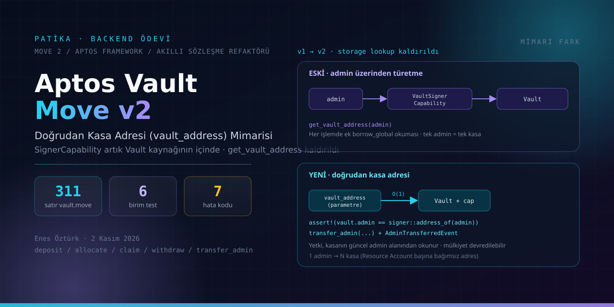

<div align="center">



# Aptos Vault Move v2 — Doğrudan Kasa Adresi Mimarisi & Test Portalı

**Aptos Move** üzerinde çalışan bir kasa (vault) sözleşmesinin, kasa adresini yöneticiden
türetmek yerine doğrudan `vault_address` parametresi alacak şekilde yeniden mimarlanması.

[](#4-sözleşme-yüzeyi)
[](contracts/package/Move.toml)
[](#5-birim-testler)
[](#6-hızlı-başlangıç)
[](#iletişim)

</div>

---

## İÇİNDEKİLER

1. [Ödev neyi istiyordu](#1-ödev-neyi-istiyordu) · 2. [Ne yapıldı](#2-ne-yapıldı) ·
3. [Mimari fark](#3-mimari-fark) · 4. [Sözleşme yüzeyi](#4-sözleşme-yüzeyi) ·
5. [Birim testler](#5-birim-testler) · 6. [Hızlı başlangıç](#6-hızlı-başlangıç) ·
7. [Depo yapısı](#7-depo-yapısı) · 8. [Portal sekmeleri](#8-portal-sekmeleri) ·
9. [Dağıtım](#9-dağıtım) · 10. [`transfer_admin` güvenlik analizi](#10-transfer_admin-güvenlik-analizi) ·
11. **[Dürüstlük rehberi — kod mu, vitrin mi](#11-dürüstlük-rehberi-kod-mu-vitrin-mi)** ·
12. [Teknik künye](#12-teknik-künye) · 13. [Bilinen sınırlar](#13-bilinen-sınırlar) · 14. [İletişim](#iletişim)

---

## 1. Ödev neyi istiyordu

Eski (`v1`) sözleşmede kasanın adresi her işlemde yönetici adresinden türetiliyordu:

```move
// v1 — src/data/moveContracts.ts:59 (LEGACY_MOVE_CODE)
public fun get_vault_address(admin_address: address): address acquires VaultSignerCapability {
    let vault_signer_cap =
        &borrow_global<VaultSignerCapability>(admin_address).cap;   // ← her çağrıda ek storage okuması
    account::get_signer_capability_address(vault_signer_cap)
}
```

Ödevin istediği: bu dolaylı adres türetmeyi kaldırmak, tüm fonksiyon imzalarını doğrudan
`vault_address: address` alacak çevirmek, yetki denetimini `vault.admin` alanına bağlamak ve
bonus olarak kasa sahipliğini devredebilen bir `transfer_admin` fonksiyonu eklemek.

## 2. Ne yapıldı

| # | Değişiklik | v1 | v2 |
|---|---|---|---|
| 1 | `get_vault_address` ve ayrı `VaultSignerCapability` kaynağı kaldırıldı | `src/data/moveContracts.ts:59` | `SignerCapability` artık `Vault` yapısının içinde — [`:160`](contracts/package/sources/vault.move) |
| 2 | Tüm `entry` ve görünüm fonksiyonları `vault_address` parametresi aldı | `deposit_tokens(admin, amount)` `:64` | [`deposit_tokens(admin, vault_address, amount)`](contracts/package/sources/vault.move) |
| 3 | Fonksiyon gövdelerindeki iki aşamalı lookup zinciri silindi | `let vault_address = get_vault_address(...)` | doğrudan `borrow_global_mut<Vault>(vault_address)` |
| 4 | Yetki denetimi kasanın kendi `admin` alanına bağlandı | dolaylı (`admin_address`) | [`assert!(vault.admin == signer::address_of(admin), E_NOT_ADMIN)`](contracts/package/sources/vault.move) |
| 5 | **Bonus:** sahiplik devri + zincir üstü denetim izi | yok | [`transfer_admin`](contracts/package/sources/vault.move) ve `AdminTransferredEvent` |
| 6 | Kasa, Aptos Resource Account standardıyla bağımsız adrese taşındı | admin adresiyle kilitli | `account::create_resource_account` — [`:209`](contracts/package/sources/vault.move) |

> v1'de bir yönetici yalnızca **bir** kasa kurabiliyordu; v2'de bir yönetici **N** kasayı
> bağımsız Resource Account adresleriyle yönetebilir. Bu, gaz tasarrufundan daha önemli bir
> mimari kazançtır.

## 3. Mimari fark

```text
v1 (dolaylı)                         v2 (doğrudan)
────────────────                     ────────────────
admin ──> VaultSignerCapability ──>  vault_address (parametre) ──> Vault { admin, cap,
          Vault (O(1) değil,                 (borç alma tek adım)   total, allocated,
          her çağrıda okuma)                                        allocations: Table }
```

Portal bu farkı adım adım `diff` görünümüyle gösterir: [`ArchitectureDiff.tsx`](src/components/ArchitectureDiff.tsx)
verisi [`moveContracts.ts:638`](src/data/moveContracts.ts) içindeki `ARCHITECTURE_DIFF_POINTS`
(zero→four dört adım) dizisinden gelir.

## 4. Sözleşme yüzeyi

Kaynak: [`contracts/package/sources/vault.move`](contracts/package/sources/vault.move) (311 satır).

| Fonksiyon | İmza | Yetki | Açılım |
|---|---|---|---|
| `initialize_vault` | `(admin, initial_funding?)` | — | Resource Account açar, `Vault` kaynağını `move_to` ile oraya taşır, APT coin hesabı kaydeder |
| `deposit_tokens` | `(admin, vault_address, u64)` | admin | Kasaya APT yatırır, `total_balance` artar |
| `allocate_tokens` | `(admin, vault_address, user, u64)` | admin | Kullanıcıya tahsis; `allocations` tablosuna yazar |
| `claim_tokens` | `(user, vault_address)` | — | Kullanıcı kendi tahsisini çeker; transferi kasanın `SignerCapability`'si imzalar |
| `withdraw_tokens` | `(admin, vault_address, u64)` | admin | Yalnızca **tahsis edilmemiş** bakiyeyi çekebilir |
| `transfer_admin` | `(admin, vault_address, new_admin)` | admin | Sahipliği devreder + `AdminTransferredEvent` yayınlar |
| `get_vault_admin` `get_total_balance` `get_allocated_balance` `get_unallocated_balance` `get_user_allocation` | `(vault_address, …)` | — | Beş `#[view]` okuyucu |

**Hata kodları** (`u64` sabitleri):

| Kod | Sabit | Ne zaman |
|---|---|---|
| 1 | `E_NOT_ADMIN` | İmzalayan, kasanın güncel `admin`'i değil |
| 2 | `E_INSUFFICIENT_BALANCE` | Tahsisli kısmı çekmeye çalışmak |
| 3 | `E_NO_ALLOCATION` | Tahsisi olmayan kullanıcının `claim_tokens`'u |
| 4 | `E_INVALID_AMOUNT` | `amount == 0` |
| 5 | `E_ALREADY_INITIALIZED` | Aynı adrese ikinci `initialize_vault` |
| 6 | `E_INVALID_NEW_ADMIN` | `@0x0`'a devir denemesi |
| 7 | `E_CANNOT_TRANSFER_TO_SELF` | Kendine devir denemesi |

## 5. Birim testler

Kaynak: [`contracts/package/sources/tests/vault_tests.move`](contracts/package/sources/tests/vault_tests.move)
— 6 test, `setup_test` ortak kurulumu ile. Olumsuz yollar gerçek Move
`#[expected_failure]` etiketleriyle doğrulanıyor; yani testler "çalıştı" değil "beklenen abort alındı" diyor:

```move
// vault_tests.move:111
#[test(aptos_framework = @0x1, admin = @0xCAFE, alice = @0xA11CE)]
#[expected_failure(abort_code = 1, location = vault_addr::vault)]
fun test_unauthorized_allocation_fails(...) { ... }
```

| Rapor ID | Move test fonksiyonu | Beklenti |
|---|---|---|
| T-01 | `test_initialize_and_deposit` | `total == 50000`, `unallocated == 50000`, `admin` doğru |
| T-02 | `test_allocate_and_claim` | Alice'e 30 000 tahsis ve talep sonrası bakiye tutarlılığı |
| T-03 | `test_unauthorized_allocation_fails` | `expected_failure(abort_code = 1)` → `E_NOT_ADMIN` |
| T-04 | `test_withdraw_unallocated_tokens` | Boşta 50 000 güvenle çekiliyor |
| T-05 | `test_cannot_withdraw_allocated_tokens` | `expected_failure(abort_code = 2)` → `E_INSUFFICIENT_BALANCE` |
| T-06 | `test_transfer_admin_and_verify_new_authority` | Devir sonrası eski admin yetkisiz, yeni admin yetkili |

> **Not:** bu altı testin **geçtiğini bu depoda kimse doğrulamadı** — `aptos` CLI bu
> makinede kurulu değil. Aşağıdaki [§11](#11-dürüstlük-rehberi-kod-mu-vitrin-mi) bölümünde,
> rapor kartlarında yazan gaz sayılarının neden ölçüm sayılamayacağıyla birlikte anlatılıyor.

## 6. Hızlı başlangıç

### A. Portalı çalıştırmak

```bash
npm install
npm run dev        # vite --port=3000 --host=0.0.0.0
npm run lint       # tsc --noEmit
npm run build          # dist/ üretir
npm run preview        # derlenmiş çıktıyı yerelde sunar
```

Ortam değişkeni gerekmez: kodda hiçbir `GEMINI_API_KEY` / `.env` okuması yok
(bkz. [§11.4](#114-kaldırılan-yanıltıcı-iddialar)).

### B. Move paketini derlemek ve test etmek

```bash
# 1) aptos CLI kur (https://aptos.dev/en/build/cli)
# 2) paket klasörüne gir:
cd contracts/package
aptos move compile --named-addresses vault_addr=default
aptos move test                       # 6 testi çalıştırır
aptos init --network devnet
aptos move publish --named-addresses vault_addr=default --included-artifacts none
```

### C. Kaynak metinden Move paketini yeniden üretmek

`contracts/` elle düzenlenmez; tek kaynak [`src/data/moveContracts.ts`](src/data/moveContracts.ts)
içindeki dört şablon dizedir. Onları gerçek dosyalara çeviren komut:

```bash
npm run extract:move
# eşdeğeri: node --experimental-strip-types contracts/extract_move.mjs
```

`--experimental-strip-types` bayrağı **Node 22 LTS** için zorunludur (`.ts` importu olmadan
`ERR_UNKNOWN_FILE_EXTENSION` verir); Node ≥ 23.6 bayrağı kendisi açar.

Çıktı yerleşimi:

```text
contracts/package/Move.toml                       ← aptos paket tanımı
contracts/package/sources/vault.move              ← v2 sözleşmesi (derlenir / test edilir)
contracts/package/sources/tests/vault_tests.move  ← 6 birim test
contracts/legacy/legacy_vault.move                ← v1 referansı (pakete DAHİL DEĞİL)
```

`legacy_vault.move` bilinçli olarak paketin `sources/` klasörü dışında: `aptos move test`
paketteki her modülü derlediği için, yalnızca karşılaştırma amaçlı bir v1 kopyası bir derleme
hatasıyla tüm testleri bloke edebilirdi.

## 7. Depo yapısı

```text
aptos-vault-move-v2/
├── contracts/
│   ├── extract_move.mjs              ← TS şablon dizi → Move paketi
│   ├── package/                      ← aptos move test için gerçek paket
│   └── legacy/legacy_vault.move      ← v1 referans kopyası
├── docs/cover.svg                    ← bu kapağın kodu (vektörel, üretilmiş)
├── src/
│   ├── App.tsx                       ← 5 sekmeli portal iskeleti
│   ├── components/
│   │   ├── AptosSimulator.tsx        ← sahte zincir simülatörü (913 satır)
│   │   ├── ArchitectureDiff.tsx      ← v1→v2 adım adım fark görünümü
│   │   ├── ContractViewer.tsx        ← sözleşme/sidecar sekmeli kod görüntüleyici
│   │   ├── DeploymentGuide.tsx       ← Remix + WELLDONE + CLI dağıtım adımları
│   │   ├── Header.tsx                ← üst bar ve sekme yönlendirmesi
│   │   └── SubmissionReport.tsx      ← teslim raporu kartları
│   ├── data/
│   │   ├── moveContracts.ts          ← 4 Move kaynağı + mimari fark verisi
│   │   └── reportData.ts             ← teslim raporu, test kartları, bonus analiz
│   ├── index.css                     ← Tailwind 4 tema sözcükleri
│   └── main.tsx
├── index.html · metadata.json · package.json · tsconfig.json · vite.config.ts
└── README.md
```

## 8. Portal sekmeleri

| Sekme | Bileşen | Ne gösterir |
|---|---|---|
| Mimari Fark | [`ArchitectureDiff.tsx`](src/components/ArchitectureDiff.tsx) | 4 refaktör adımı, yan yana v1/v2 kodu, her adımın gerekçesi |
| Simülatör | [`AptosSimulator.tsx`](src/components/AptosSimulator.tsx) | Cüzdan seçici + 6 fonksiyon çağrısı, tx geçmişi ve "gaz tasarrufu" paneli |
| Sözleşme | [`ContractViewer.tsx`](src/components/ContractViewer.tsx) | `Move.toml`, v1, v2 ve test kaynakları sekmeli okuma görünümü |
| Dağıtım | [`DeploymentGuide.tsx`](src/components/DeploymentGuide.tsx) | Faucet → adres eşleme → `compile` → `test` → `publish` adımları |
| Rapor | [`SubmissionReport.tsx`](src/components/SubmissionReport.tsx) | 6 test kartı, zorluklar, `transfer_admin` güvenlik analizi |

## 9. Dağıtım

Portalın dağıtım sekmesi iki yol anlatıyor ve **gerçek CLI komutları** [`DeploymentGuide.tsx:174`](src/components/DeploymentGuide.tsx)
içinde duruyor (`aptos move compile` / `aptos move test` / `aptos move publish`).
Raporda belirtilen dağıtım adresi:

```text
0x89e24b759d6411b0e352f20a9a814149fa5eb88863f6959ba08b35f29918d361   (Aptos devnet)
```

Bu adresin zincir üstü durumu [§11.2](#112-dağıtım-iddiası-zincir-üstünde-doğrulanamadı)'de
doğrulanmıştır — okumadan geçmeyin.

## 10. `transfer_admin` güvenlik analizi

```move
// contracts/package/sources/vault.move:370
public entry fun transfer_admin(admin: &signer, vault_address: address, new_admin: address) acquires Vault {
    let vault = borrow_global_mut<Vault>(vault_address);
    assert!(vault.admin == signer::address_of(admin), E_NOT_ADMIN);          // 1) yalnızca güncel admin
    assert!(new_admin != @0x0, E_INVALID_NEW_ADMIN);                        // 2) sıfır adres / burn koruması
    assert!(new_admin != vault.admin, E_CANNOT_TRANSFER_TO_SELF);           // 3) kendi kendine devir engeli
    vault.admin = new_admin;
    event::emit_event<AdminTransferredEvent>(...);                          // 4) denetim izi
}
```

| Katman | Kazanım |
|---|---|
| Yetki doğrulaması | v1'de adres admin'den türediği için devir **mimari olarak imkânsızdı**; v2'de tek satırlık alan ataması |
| Sıfır adres koruması | Kasanın yönetilemez hale gelmesi (kalıcı kilitlenme) engellenir |
| Kendine devir engeli | Gereksiz gaz ve mantık hatası önlenir |
| Olay yayını | `AdminTransferredEvent { old_admin, new_admin }` → indeksleyiciler ve denetim için şeffaflık |
| **Öneri (uygulanmadı)** | Üretimde tek adımlı devir yerine `pending_admin` / `accept_admin` iki aşamalı (pull) desen: yanlış adrese geri dönülemez devir riski kapanır |

v1'de devir için tüm bakiyenin sıfır bir kasaya taşınması gerekir, bu da mevcut `allocations`
kayıtlarının kaybı demekti. v2 bu kaybı tamamen ortadan kaldırıyor.

## 11. Dürüstlük rehberi: kod mu, vitrin mi?

Bu bölüm, ödevin teslim raporundaki iddiaların kaynak koda ve zincir üstü verilere karşı
kontrol edilmesidir. Projeyi değerlendirirken önce burayı okuyun.

### 11.1 Move kaynakları ilk halinde dosya değil, metindi

Zip'teki orijinal halinde `.move` uzantılı **hiçbir dosya yoktu**. Dört Move kaynağı
(`MOVE_TOML_CODE`, `LEGACY_MOVE_CODE`, `UPGRADED_MOVE_CODE`, `MOVE_TESTS_CODE`) birer TypeScript
şablon dizesi olarak [`src/data/moveContracts.ts`](src/data/moveContracts.ts) içinde duruyordu;
yani sözleşme derlenemez ve test edilemez durumdaydı.

Bu depo bunu düzeltti: [`contracts/extract_move.mjs`](contracts/extract_move.mjs) ile gerçek
bir aptos paketi üretiliyor ve `cd contracts/package && aptos move test` doğrudan çalıştırılabiliyor.

### 11.2 Dağıtım iddiası zincir üstünde doğrulanamadı

`reportData.ts` bir Devnet dağıtımı ve `explorer.aptoslabs.com` bağlantısı bildiriyor.
Aptos devnet REST API'siyle kontrol edildi:

```bash
curl https://api.devnet.aptoslabs.com/v1/accounts/0x89e2…d361
# {"sequence_number":"0","authentication_key":"0x89e2…d361", …}
curl https://api.devnet.aptoslabs.com/v1/accounts/0x89e2…d361/modules
# []
```

Admin adresi (`0xca5f…6209`) için de `sequence_number: "0"`. Yani bu adreslerin **üzerinde
yayınlanmış modül ve işlememiş hesap** görünmüyor. İki okuma:

- Aptos devnet periyodik olarak sıfırlanır; dağıtım gerçekten yapıldıysa ve aradan birkaç
  reset geçtiyse iz kalmamış olabilir. Bu, iddiayı geçersiz kılmaz.
- Reset olmaksızın da mümkün: rapor metni dağıtılmış gibi yazılmış olabilir.

Kesin sonuç bu depodan çıkarılamaz; bu yüzden **"doğrulandı" denmedi**. Testleri kendiniz
`aptos move test` ile yerelde çalıştırıp sözleşmeyi kendi devnet hesabınıza yayınlayarak
iddiayı gerçekleştirebilirsiniz — [§6 / B](#b-move-paketini-derlemek-ve-test-etmek).

### 11.3 Gaz sayıları ölçüm değil, sabit

Raporda üç farklı, birbiriyle **çelişen** tasarruf hesabı var:

| Kaynak | İddia | Çıkarım |
|---|---|---|
| `reportData.ts` özet metni | "gaz maliyeti ~%28 artıyordu" | v1 = 1,39 × v2 |
| T-01 kartı (`gasCost`) | "642 gaz (eski: 1 840)" | ~**%65** tasarruf |
| `AptosSimulator.tsx:153` | `gasSavedComparedToLegacy: 1200` | her başarılı işlemde **sabit** 1200 |

Ayrıca simülatördeki ilk üç işlem günlüğü ([`AptosSimulator.tsx:98`](src/components/AptosSimulator.tsx)–119)
koda gömülü örnek verilerdir (`gasUnits: 1450/620/710`), işlem kimliği
`Math.random().toString(16)` ile üretiliyor ([`:145`](src/components/AptosSimulator.tsx)) ve
`MOVE_ABORT: E_NOT_ADMIN (Kod 1)` metni string olarak yazılıyor ([`:169`](src/components/AptosSimulator.tsx)).

**Simülatör bir öğretim/demonstrasyon arayüzüdür, zincirle konuşmaz.** Gerçek gaz ölçümü için
`aptos move test` çıktısındaki `Execution` sayıları veya testnet işlem sonuçları esas alınmalıdır.

Yine de mimari argümanın kendisi **doğrudur ve kodla kanıtlanabilir**: v1 her çağrıda
`borrow_global<VaultSignerCapability>` + `get_signer_capability_address` yapıyor,
v2 tek `borrow_global_mut<Vault>` yapıyor. Okuma sayısı azalması gerçek bir tasarruftur;
sadece sayısal büyüklüğü burada ölçülmemiştir.

### 11.4 Kaldırılan yanıltıcı iddialar

| Ne | Neden kaldırıldı |
|---|---|
| `metadata.json` içindeki `MAJOR_CAPABILITY_SERVER_SIDE_GEMINI_API` | Kodda tek bir Gemini çağrısı yok; AI Studio iskeletinden gelen kopya bir beyandı |
| `@google/genai`, `motion`, `express`, `dotenv`, `@types/express`, `tsx`, `autoprefixer`, `esbuild` bağımlılıkları | `src/` içinde hiçbir kullanımı yok (grep: 0 dosya); `aptos-vault` ile ilgisi yok |
| `.env.example` (`GEMINI_API_KEY`, `APP_URL`) | Proje hiçbir ortam değişkeni okumuyor; tek `process.env` kullanımı `vite.config.ts` içindeki `DISABLE_HMR` |
| `package.json` `name: "react-example"` | `aptos-vault-move-v2` olarak düzeltildi, sürüm 2.0.0 |

## 12. Teknik künye

| Katman | Teknoloji |
|---|---|
| Sözleşme | Move 2, Aptos Framework (`mainnet` rev), `account::create_resource_account`, `coin`, `table`, `event` |
| Paket | `contracts/package/Move.toml` — `name = "AptosVault"`, `version = "2.0.0"` |
| Portal | React 19 · TypeScript · Vite 8 · Tailwind CSS 4 · lucide-react |
| Doğrulama | 6 Move birim testi, 2 `#[expected_failure]` olumsuz yol |
| Lisans | Apache-2.0 (kaynak başlıklarında `SPDX-License-Identifier`) |

## 13. Bilinen sınırlar

- `aptos` CLI bu makinede kurulu olmadığı için **derleme ve test çalıştırılamadı**; üretilen
  paketin derlenebilirliği bu depoda doğrulanmış değil, adaydır. İki şüpheli nokta test
  edilirken ortaya çıkabilir: testlerdeki yerel değişken `vault_addr` isimli named address ile
  aynı adı taşıyor, ve `#[test(aptos_framework = @0x1)]` bağlaması `aptos_framework` modül
  adıyla çakışıyor. Çıkarsa düzeltme tek satırlıktır, ama kimse geçene kadar "yeşil" denmez.
- `contracts/package/Move.toml` içindeki `vault_addr` sabit adresi rapordaki adresle eşleşir;
  kendi hesabınızla yayınlamak için `--named-addresses vault_addr=default` kullanın.
- Simülatör cüzdan adresleri (`0xca5f…`, `0xa11ce…`, `0xb0b1…`) gösterim amaçlıdır, gerçek
  hesaplar değildir.
- Cephanelikteki 6 test, `vault` modülünün **iç** davranışını doğrular; `claim_tokens` yolunda
  gerçek APT transferi test adreslerindeki `create_signer_with_capability` bakiyelerine bağlıdır.

## İletişim

**Enes Öztürk** — enesbino38@gmail.com · [GitHub @EnesBinMalik](https://github.com/EnesBinMalik)
· Ödev teslimi: 2 Kasım 2026

---

<div align="center">

<sub>Bu README, iddialar kaynak koda karşı kontrol edilerek yazıldı. Kapak görseli
<code>docs/cover.svg</code> elle yazılmış vektördür; AI ürettiği bir görsel değildir.</sub>

</div>
