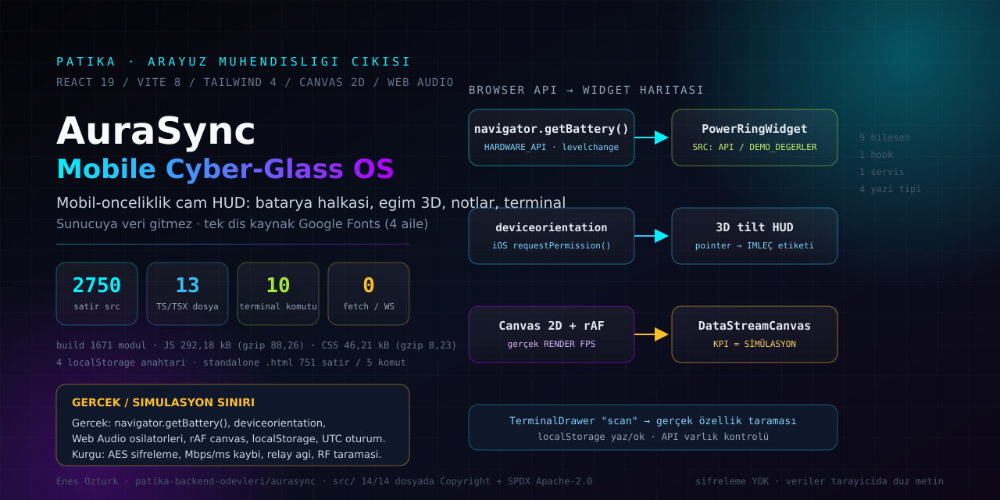

<div align="center">

# AuraSync // Mobile Cyber-Glass OS




**Tasarım, kod ve tüm haklar: [Enes Öztürk](https://github.com/EnesBinMalik)** · © 2026

</div>

> AuraSync mobil-öncelikli bir **web OS arayüzüdür**. Batarya halkası, eğim (tilt) 3D, notlar, terminal
> ve canvas telemetrisi tarayıcı API'leriyle gerçekten çalışır; **Mbps/ms/packet-loss gibi "ağ" sayıları,
> AES şifreleme ve RF taraması ise arayüzün dekorasyonudur**. Aşağıdaki [§4](#4-dürüstlük-rehberi-gerçek-olan--kurgu-olan)
> her ikisini de kaynak satırıyla ayırır.

---

## 1. Ne var, ne yok

| Var (tarayıcıda doğrulandı) | Yok (hiç iddia edilmiyor) |
|---|---|
| `navigator.getBattery()` okuması + `levelchange` dinleyicisi (temizlenir) | Sunucu, hesap, sinkronizasyon, bulut yedeği |
| `deviceorientation` eğimi; iOS'ta `requestPermission()`; yoksa imleçten türetilen tilt | "Sensör varsa bile" gerçek cihaz kimliği/jiroskop kalibrasyonu |
| Web Audio API osilatörleriyle üretilen efekt sesleri (`click`/`chirp`/`beep`/`warning`) | Ses dosyası, sample pack, sesli asistan |
| Canvas 2D veri akışı + `requestAnimationFrame`'ten **ölçülen RENDER FPS** | Gerçek throughput/latency/packet-loss ölçümü (hepsi `sim`) |
| `localStorage` notları ve ses tercihi (düz metin) | Şifreleme — `ENCRYPTED` rozeti yalnızca bir etikettir |
| 10 komutluk terminal + ↑/↓ geçmişi + **gerçek özellik taraması** (`scan`) | RF/Bluetooth taraması, ağ keşfi, kırma/decrypt işlevi |
| Tek dosyalık `public/aurasync-standalone.html` (751 satır, 5 komut) | Harici JS framework'ü o dosyada; bağımlılıksız vanilla JS'tir |

## 2. Çalıştırma

```bash
npm install
npm run dev        # vite --port=3000 --host=0.0.0.0
npm run lint       # tsc --noEmit  → 0 hata
npm run build      # 1671 modül, çıktılar §6'da
npm run preview
```

Kurulum notu: `package.json` bilerek `esbuild` pinlemiyor — Vite 8'in peer aralığı (`^0.27 || ^0.28`)
ile çakışan eski pin `npm install`'ı `ERESOLVE` ile durduruyordu.

## 3. Dosya haritası

```text
aurasync/
├── index.html                     ← 22 satır: meta + Google Fonts (4 aile) + #root
├── src/
│   ├── App.tsx (277)              ← HUD yerleşimi; başlıkta GERÇEK/DEKORATİF listesi
│   ├── components/                ← 9 bileşen, 1.958 satır
│   │   ├── MobileTopBar.tsx       ← DECOR çipi, GYRO AKTİF/3D durumu
│   │   ├── PowerRingWidget.tsx    ← SRC: HARDWARE_API / DEMO_DEGERLER
│   │   ├── CyberControlsWidget.tsx← ANİMASYON HIZI (GHz değil), EĞİM KAYNAĞI
│   │   ├── DataStreamCanvas.tsx   ← ölçülen RENDER FPS + SİMÜLASYON etiketli KPI
│   │   ├── TerminalDrawer.tsx     ← status/scan/out … (gerçek + kurgu ayrımı)
│   │   ├── NeuralNotes.tsx        ← localStorage notları, rozar = etiket
│   │   ├── ArchitectHUD.tsx       ← İMZA BEYANI (biyometri görsel animasyondur)
│   │   ├── MatrixRainOverlay.tsx, MobileTabBar.tsx
│   ├── hooks/useDeviceSensors.ts  ← batarya + eğim + sayaçlar (293 satır)
│   ├── services/soundFx.ts        ← Web Audio sentezi + mute kalıcılığı
│   └── main.tsx, index.css
├── public/aurasync-standalone.html← bağımlılıksız tek dosya kopya (751 satır)
├── docs/cover.svg                 ← bu kapağın elle yazılmış vektörü
└── metadata.json                  ← "majorCapabilities": [] (Gemini iddiası kaldırıldı)
```

## 4. Dürüstlük rehberi: gerçek olan ↔ kurgu olan

| Arayüzde görünen | Durum | Kaynak (dosya:satır) |
|---|---|---|
| Batarya %'si, şarj durumu | Gerçek API; yoksa `DEMO_DEGERLER` yazar | `useDeviceSensors.ts:104` → `nav.getBattery()` |
| "Dolu Kalan / Bitme Süresi" | Gerçek `chargingTime`/`dischargingTime`; `API VERMEZ` dallı | `PowerRingWidget.tsx:27` → `secondsToLabel()` |
| Voltage "tahmini", Temp "model" | Etiketli türetme — sensör okuması değil | `PowerRingWidget.tsx` gauge satırları |
| 3D tilt açısı | Gerçek sensör **veya** imleçten türetilmiş; `source` alanı ayırır | `useDeviceSensors.ts:183` `handleOrientation`, pointer dalı `source: 'pointer'` |
| Gyro izin akışı | iOS `requestPermission()` gerçek; yoksa `isSupported: false` | `useDeviceSensors.ts:254` `requestGyroPermission()` |
| Efekt sesleri | Gerçek osilatör + gain ramp | `soundFx.ts:48` `createOscillator()` |
| RENDER FPS | `requestAnimationFrame` kare sayısından ölçülüyor | `DataStreamCanvas.tsx:40-53` |
| Throughput / Ping / Loss KPI'ları | Simülasyon; `(sim)` + `DEKOR` etiketli | `DataStreamCanvas.tsx` KPI şeridi |
| Notlar | Gerçek `localStorage`, **düz metin** | `NeuralNotes.tsx:56`/`:79` `aurasync_neural_notes` |
| `ENCRYPTED` rozeti | Yalnızca etiket; şifreleme yok | `NeuralNotes.tsx:105` → `:323` |
| `status` komutu | Gerçek olgular: sürüm, batarya kaynağı, tilt kaynağı, uptime | `TerminalDrawer.tsx:83` |
| `scan` komutu | **Gerçek** özellik taraması: localStorage yaz/ok, API varlığı, viewport | `TerminalDrawer.tsx:126` |
| `sync` / `decrypt` / `overclock` | SİMÜLASYON / KURGU / animasyon hızı (GHz iddiası yok) | `TerminalDrawer.tsx` switch dalları |
| Decoratif "894" jitter | Üst çubukta `DECOR` çipi + tooltip | `useDeviceSensors.ts:69` → `MobileTopBar.tsx` |
| Ağ isteği | `fetch`/`WebSocket`/`EventSource` **yok**; yalnızca Google Fonts | tüm `src/` taramasında 0 çağrı |

Kalıcılık anahtarları (4): `aurasync_neural_notes`, `aurasync_audio_muted` (React),
`aurasync_probe` (`scan` anlık testi), `aurasync_notes_raw` (standalone dosyası).

## 5. Bu oturumda düzeltilen gerçek kusurlar

1. **Batarya dinleyici sızıntısı**: `removeEventListener('levelchange', () => {})` yeni kapanış
   gönderdiği için dinleyici hiç kopmuyordu; `batteryUpdate` tek referans olarak saklanıp
   cleanup'ta kaldırıldı, ayrıca `isMounted` koruması eklendi.
2. **`isEncrypted` ölü bayrağı** not kartında hiç render edilmiyordu → gerçek bir rozet oldu
   ("yalnızca etiket, içerik düz metin" tooltip'iyle).
3. **Yanlış `isSupported: true`** iddiası: gyro izni yokken de "supported" dönüyordu → API
   yoksa `false`.
4. **Standalone not üretimi `innerHTML` şablonu** kullanıyordu (stored-XSS biçiminde batık) →
   `createElement` + `textContent` ve `addEventListener` ile yeniden yazıldı.
5. **"0 ağ isteği / %100 çevrimdışı" iddiası yanlıştı**: arayüz Google Fonts indiriyor →
   tüm metinler "veri isteği yok; tek dış kaynak Google Fonts" olarak düzeltildi.
6. Uydurma donanım sayıları (`96kHz/24-bit`, `Cell Health 98% · PRIME`, GHz overclock, sahte RF
   taraması) kaldırıldı veya ölçülen/eşelenen değerlerle değiştirildi.
7. `metadata.json` içindeki `MAJOR_CAPABILITY_SERVER_SIDE_GEMINI_API` silindi — bu uygulamada
   sunucu ve anahtar yok.

## 6. Doğrulama

```text
$ npm run lint      → tsc --noEmit, 0 hata
$ npm run build     → ✓ 1671 modules transformed
  dist/index.html                 1.87 kB │ gzip:  0.89 kB
  dist/assets/index-*.css        46.21 kB │ gzip:  8.23 kB
  dist/assets/index-*.js        292.18 kB │ gzip: 88.26 kB
```

Tarayıcıda doğrulananlar (Chrome, `vite preview`):

- `navigator.getBattery()` bu testte **`HARDWARE_API`** kaynağını döndürdü; halkanın `SRC:` etiketi
  buna göre değişiyor (API'siz tarayıcıda `DEMO_DEGERLER`).
- Eğim kaynağı etiketi olay gelmeden `BEKLENIOR`, imleç hareketiyle `IMLEÇ` oldu — sensör
  taklidiyle gerçek sensör karıştırılmıyor.
- `scan` çıktıları gerçek: localStorage yaz/ok başarılı, AudioContext var, viewport + DPR okundu.
- Ağ kaydı yalnızca `fonts.googleapis.com` (1 CSS) + `fonts.gstatic.com` (woff2) + yerel asset'ler.
- 632 px genişlikte yatay taşma yok; konsol hatası yok.

## 7. Sınırlar

- Battery Status API'i Chromium'a özgüdür; Firefox/Safari'de halka `DEMO_DEGERLER` etiketiyle düşer.
- `deviceorientation` iOS'ta kullanıcı izni + HTTPS ister; izin verilmezse tilt imleçe düşer.
- `localStorage` kota/yasak durumlarında sessizce `console.warn` üretir (not kaybı riski buradadır).
- Erişilebilirlik: araç ipuçları ve `aria-label`'ler var; tam klavye gezinmesi ve hareket azaltma
  yolu test edilmedi.
- Standalone dosya React sürümünün **alt kümesidir** (5 komut); iki kopya birbirinden ayrı gelişebilir.

## 8. Telif ve imza

Tasarım ve kod **Enes Öztürk**'e aittir; katkı hakları (telif) saklıdır. Kaynak dosyalar
`SPDX-License-Identifier: Apache-2.0` başlığıyla dağıtılır. Arayüzün `about` komutu ve
mimari HUD'u bu beyanı taşır:

```
AURASYNC // MOBILE CYBER-GLASS OS
Designed & Architected by Enes Öztürk
Sürüm: 1.0.0 · veri isteği: 0 (yalnızca Google Fonts yüklenir)
```
