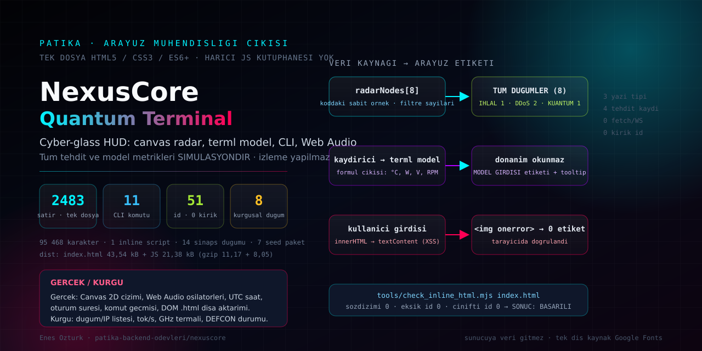

<div align="center">

# NexusCore // AI Quantum Terminal & Threat Visualizer




**Tasarım, kod ve tüm haklar: [Enes Öztürk](https://github.com/EnesBinMalik)** · © 2026

</div>

> Bu proje bir **arayüz demodur**, izleme ürünü değildir. Radar, token metrikleri, termal gauges ve
> DEFCON rozeti gerçek bir sisteme bağlı değildir; kodda sabit örnek veri ve formül çıktısıdır.
> Bu ayrım arayüzün içinde de yazıyor — aşağıdaki [§5](#5-dürüstlük-rehberi-gerçek-olan--kurgu-olan) tablosu ise
> her iddianın kaynak koddaki karşılığını verir.

---

## 1. Ne var, ne yok

| Var (çalışır durumda) | Yok (hiç iddia edilmiyor) |
|---|---|
| Canvas 2D radar: dönen süpürme, bezier paket yolları, düğüm halkaları | Gerçek ağ/alet izleme, sensör okuma |
| Web Audio API ile **sentezlenen** efekt sesleri (osilatör, gain ramp) | Ses dosyası, harici ses kütüphanesi |
| CLI: 11 komut, zincirleme typewriter log, geçmiş gezinme (↑/↓), kuyruk | Shell erişimi, yetki yükseltme, komut çalıştırma |
| UTC saat + oturum süresi sayacı (gerçek zaman) | Sunucuya telemetri gönderimi (`fetch`/`WebSocket` yok) |
| Kaydırıcı → termal model formülü (°C, W, V, RPM) | Donanım saati/güç okuması veya kontrolü |
| Tek DOM düğümünü `.html` olarak dışa aktarma | Derleme hash’i, imza, doğrulanabilir build |

## 2. Çalıştırma

```bash
npm install          # tek bağımlılık: vite ^8
npm run dev          # http://localhost:3000
npm run check        # tools/check_inline_html.mjs index.html  → statik denetim
npm run build        # dist/ (Vite, inline modülü asset'e çıkarır)
npm run preview
```

`index.html` kendi başına da çalışır: dosyayı tarayıcıda açmak yeterlidir. Uygulamanın **kendisi**
tek dosyalıktır; `npm run build` yalnızca o inline modülü optimize edilmiş bir asset'e böler.

## 3. Dosya haritası

```text
nexuscore/
├── index.html                 ← 2.483 satır: markup + CSS + ES6+ modül (tek uygulama dosyası)
├── tools/check_inline_html.mjs← kendi yazdığımız statik denetleyici (bkz. §6)
├── docs/cover.svg             ← bu kapağın elle yazılmış vektörü
├── metadata.json              ← ad + dürüst açıklama ( Gemini/başka "capability" iddiası yok )
├── vite.config.ts / package.json
└── README.md
```

## 4. Etkileşim yüzeyi

- **Radar (`radarCanvas`)**: `requestAnimationFrame` döngüsü; 8 düğüm, 7 seed paket, bezier yaylar.
  İmleç hareketi `PROBE: LAT/LON` etiketini üretir (imleç koordinatından türetilir, GPS değildir),
  tıklama `radarNodes` içinde 0.06 yarıçaplı hit-test yapar ve **kodda yazılı kaydı** loglar.
- **Filtreler**: `TÜM DÜĞÜMLER / İHLAL / DDoS / KUANTUM` sayaçları artık `state.radarNodes` üzerinden
  hesaplanır; `temizle` sonrası 0'a düşer. Eskiden sabit yazılmış `(3)(3)(2)` sayıları veriyle uyuşmuyordu.
- **AI paneli**: dört metrik (tok/s, coherence, KV-cache, entropy) 1 sn'lik zamanlayıcı + formül çıktısı.
  `DEMO ÇEVRİM` düğmesi çubuğu %100'e çeker, etikete `384.2 tok/s` yazar — inference yoktur.
- **Termal panel**: CPU/GPU kaydırıcıları `updateHardwareMetrics()` formülünü besler; gauge, güç,
  gerilim ve `thermalStatusTag` bu formülün sonucudur. Bellek gauge'ı **hiç güncellenmeyen** sabit örnektir.
- **CLI komutları** (11): `help`, `scan`, `quantum_sync`, `ai_status`, `override`, `threat_purge`,
  `throttle_max`, `matrix`, `architect`, `whoami`, `clear`. Her çıktı, ürettiği şeyin animasyon mu,
  formül mü, sabit örnek mi olduğunu kendisi söyler.
- **DEFCON rozeti**: yalnızca renk/tema anahtarıdır; `override` da onu değiştirir.

## 5. Dürüstlük rehberi: gerçek olan ↔ kurgu olan

| Arayüzde görünen | Durum | Kaynak (dosya:satır) |
|---|---|---|
| `GLOBAL THREAT VECTOR RADAR · SİMÜLASYON` | Kurgusal veri, gerçek animasyon | [index.html:1132](index.html#L1132), çizim `drawRadar()` [index.html:1624](index.html#L1624) |
| 8 radar düğümü + IP'ler | Kodda sabit örnek kayıt | [index.html:1571](index.html#L1571) |
| Filtre sayaçları (8/1/2/1) | `radarNodes` üzerinden hesaplanır | `updateFilterCounts()` [index.html:2276](index.html#L2276) |
| 4 tehdit akışı satırı | Sabit örnek; zamanla üremiyor | [index.html:1582](index.html#L1582) |
| tok/s · coherence · KV-cache · entropy | 1 sn'lik zamanlayıcı + formül | `setInterval` [index.html:2361](index.html#L2361) |
| LATENT DIM 8.192 / HEADS 64 / SPARSITY %92.4 | Sabit yazılmış; JS güncellemez | [index.html:1236](index.html#L1236) |
| °C / W / V / RPM | Kaydırıcı girdili termal model | `updateHardwareMetrics()` [index.html:1924](index.html#L1924) |
| VRAM %72 · 184.3/256 GB | Sabit demo değeri (güncellenmez) | [index.html:1298](index.html#L1298) |
| `Q-ENTROPY 0.03xx ΔE` | `Math.random()` dekorasyonu | [index.html:2370](index.html#L2370) |
| `TOPOLOJİ: 14 DÜĞÜM` | Gerçek canvas animasyonu, kurgusal anlam | düğüm döngüsü `i < 14` [index.html:1843](index.html#L1843) |
| UTC saat + `OTURUM` sayacı | Gerçek (`new Date()`, `uptimeSeconds`) | [index.html:2361](index.html#L2361) |
| Web Audio sesleri | Gerçek (`OscillatorNode` + `GainNode`) | `class CyberAudioEngine` [index.html:1483](index.html#L1483) |
| `.html` dışa aktarımı | Gerçek (`Blob` + `createObjectURL`) | `exportStandaloneHTML()` [index.html:2463](index.html#L2463) |
| Ağ trafiği | Yalnızca Google Fonts (3 aile CSS + woff2) | istek kaydı §6'da; `fetch(` taramada 0 sonuç |

## 6. Doğrulama

```text
$ node tools/check_inline_html.mjs index.html
dosya            : index.html
html boyutu      : 95468 karakter / 2483 satir
inline script    : 1
tanimli id       : 51
sozdizimi hata   : 0
eksik id erisimi : 0
cinifti id       : 0
SONUC: BASARILI

$ npm run build
dist/index.html                43.54 kB │ gzip: 11.17 kB
dist/assets/index-BjK0OIW1.js  21.38 kB │ gzip:  8.05 kB
```

Denetleyici üç şeyi arar: inline `<script>` bloğunun söz dizimi (`node:vm` `Script`),
`getElementById`/`querySelector('#…')` ile istenen her `id`'nin HTML'de gerçekten tanımlı olması,
ve çift `id`. Bu tarama, elle bakmanın kaçırdığı "buton var, handler'ı yok" tipi kırıkları kapatıyor.

Tarayıcıda doğrulananlar:

- `scan` komutu artık gerçek veri sayısını yazıyor: `4 düğümde etiketli tehdit var` + düğüm adları.
- Filtre sayaçları `temizle` sonrası `İHLAL (0) · DDoS (0) · KUANTUM (0)` oldu (canlı hesaplama).
- CLI girdisine `` yazıldı: terminalde **0 ``** üretildi, işaretçi tetiklenmedi.
- Konsol hatası yok; 632 px genişlikte yatay taşma yok (`scrollWidth - innerWidth = -15`).
- Ağ kaydı: dış istekler yalnızca `fonts.googleapis.com` (1 CSS) + `fonts.gstatic.com` (woff2).

## 7. Bu oturumda düzeltilen gerçek kusurlar

1. **Sabit `uptimeSeconds: 252`** → `0`; sayaç artık gerçekten oturum süresini sayıyor.
2. **Filtre sayaçları veriyle uyuşmuyordu** (3/3/2 yazılıyordu, gerçek dağılım 1/2/1) → `radarNodes`'tan hesaplandı.
3. **İki `innerHTML` batığı**: CLI yankısı ve tehdit akışı şablonu kullanıcı/metin verisini HTML'e çeviriyordu
   → `createElement` + `textContent` ile yeniden yazıldı (bkz. §6 XSS testi).
4. **`NEURAL TOPOLOGY: 16-CLUSTER`** etiketi 14 düğüm çiziyordu → sayı düzeltildi.
5. **Uydurma sabitler**: `Cryptographic Build Hash: 0x9F8C..4B2E`, `KERNEL: QUANTUM-RT-6.11`,
   `CLEARANCE LEVEL: ALPHA-OMEGA` → hesaplanmayan/var olmayan iddialar metinden çıkarıldı.
6. **`metadata.json` içindeki `MAJOR_CAPABILITY_SERVER_SIDE_GEMINI_API`** → silindi (sunucu yok, anahtar yok).
7. Ölü dosyalar (`src/App.tsx`, `src/main.tsx`, `index.css`, `tsconfig.json`, `.env.example`) ve
   AI Studio'nun `GEMINI_API_KEY` anlatan README'si kaldırıldı.

## 8. Sınırlar

- Veri kalıcılığı yok: yenilemede her şey baştan; `localStorage` kullanılmıyor.
- `prefers-reduced-motion` için ayrı yol yok; animasyon `rAF` sekme görünürken çalışır.
- Erişilebilirlik: araç ipuçları ve `aria-label`'ler eklendi, ancak renkli HUD yüksek kontrast iddiası taşımaz.
- Google Fonts engellenirse arayüz sistem yazı tipiyle düşer (çözünürlük değişir, işlev değişmez).

## 9. Telif ve imza

Bu çalışmanın tasarımı ve kodu **Enes Öztürk**'e aittir; katkı hakları (telif) saklıdır.
Bu klasördeki yardımcı dosyalar (`vite.config.ts`, `tools/check_inline_html.mjs`)
`SPDX-License-Identifier: Apache-2.0` başlığını taşır; tek dosyalık `index.html`
beyanı `<head>` içindeki meta etiketleriyle verir (satır 11–12) ve altbilgide de yazar
satırı vardır. Depo kökündeki `LICENSE` ve `NOTICE` bu klasörün tamamını kapsar.
Arayüz künyesi (`index.html` altbilgi ve `SYSTEM SPECS` dökümanı) yazar beyanını içerir:

```
© 2026 Enes Öztürk · tüm hakları saklıdır
KOD: Tek dosyalık HTML · derleme hash'i yok · ÇEKİRDEK: TARAYICI (JS/CSS)
```
